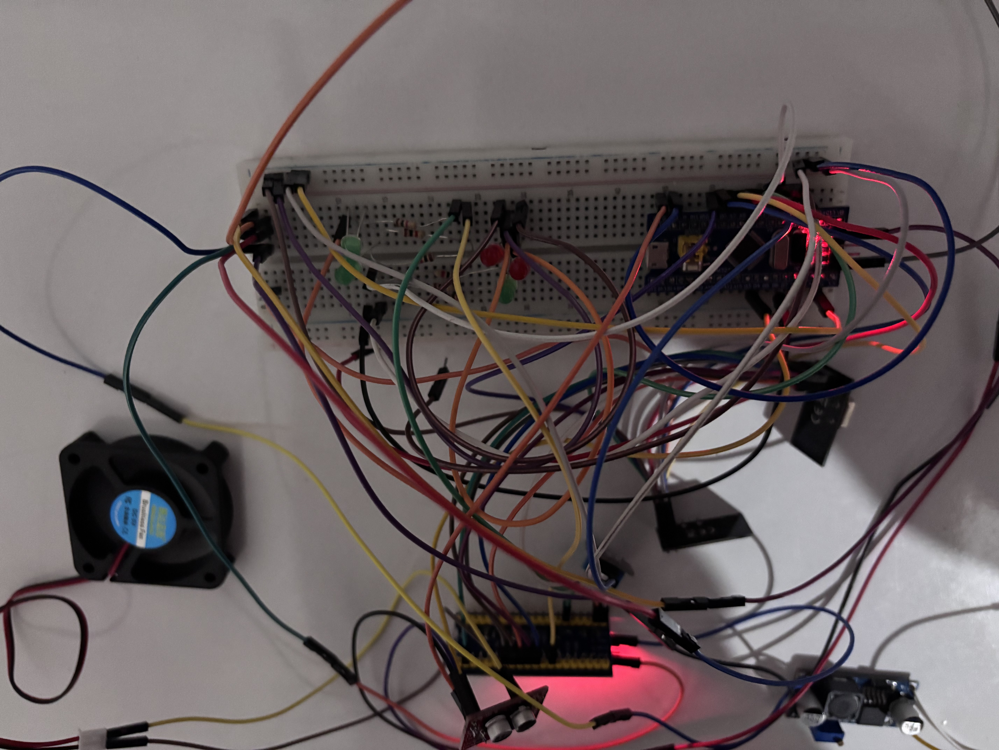
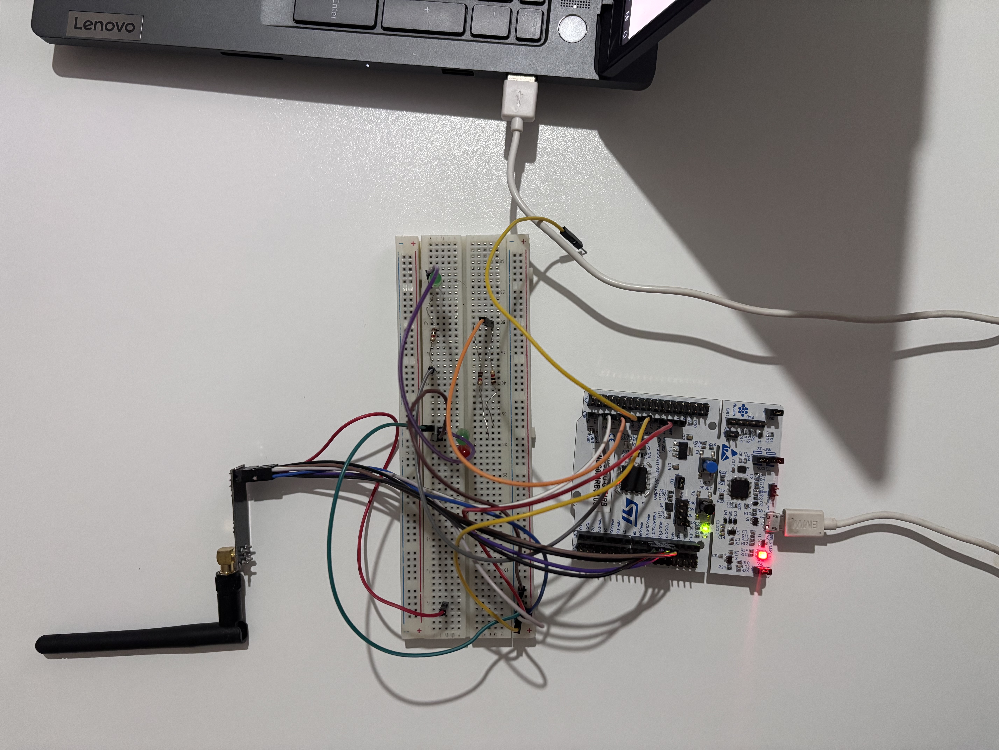

# STM32 ve .NET Tabanlı Akıllı Ev Telemetri ve Otomasyon Sistemi

Bu depo, uçtan uca kablosuz haberleşme, gömülü işletim sistemleri, kapalı çevrim kontrol algoritmaları ve modern web teknolojilerini bir araya getiren kapsamlı bir Nesnelerin İnterneti projesini içermektedir. Sistem donanım seviyesinden başlayarak sensör verilerinin toplanması, kablosuz aktarımı, ağ geçidi üzerinden sunucuya iletilmesi ve bir web uygulaması üzerinden gerçek zamanlı yönetilmesini sağlar.

## Proje Medyaları

Sistemin donanım kurulumu, ağ mimarisi ve web arayüzünün çalışmasını gösteren dosyalar aşağıda incelenebilir.

### Proje Çalışma Videosu
*(Videoyu izlemek için aşağıdaki görsele veya bağlantıya tıklayın)*

### Donanım ve Arayüz Görselleri

  
  

## Sistem Mimarisi ve Donanım Bileşenleri

Sistem bir adet merkez ağ geçidi ve iki adet bağımsız uç noktadan oluşmaktadır. Uç noktalar gücünü dışarıdan bağlanan lityum batarya ve XL4015 voltaj düşürücü modüller üzerinden alarak tamamen kablosuz çalışmaktadır.

* **Ağ Geçidi (STM32G071RB):** Sistemin ana yöneticisidir. Mikrodenetleyici üzerinde FreeRTOS işletim sistemi koşmaktadır. NRF24L01 modülü ile uç noktalardan gelen telemetri verilerini toplar ve çoklu görev mimarisi ile UART üzerinden eşzamanlı olarak bilgisayar sunucusuna aktarır. Sunucudan gelen UART komutlarını işleyerek ilgili uç noktalara kablosuz olarak yönlendirir.

* **Oda 1 (STM32F103):** Odanın iklimlendirme ve aydınlatma donanımlarını içerir. İki adet röle kontrollü LED, DHT11 sıcaklık sensörü ve bir adet DC Fan barındırır. Fan donanımı harici bir adaptör ve MX1508 H-Köprüsü motor sürücü üzerinden Oransal İntegral Türev (PID) algoritması ile dinamik olarak kontrol edilir. JTAG hata ayıklama pinleri donanımsal olarak AFIO register düzeyinde yeniden haritalandırılarak PB4 pini üzerinden 1 kHz frekansında PWM sinyali üretilmesi sağlanmıştır.

* **Oda 2 (STM32F103):** Bağımsız aydınlatma kontrolünü sağlar. Web arayüzünden tetiklenen komutlar ile iki adet LED donanımını yönetir ve durum bilgisini ağ geçidine raporlar.

## İletişim Protokolü ve Veri Çerçevesi Yapısı

Veri paketlerinin çarpışmasını ve hatalı iletimi önlemek amacıyla C başlık dosyalarında 11 bayt uzunluğunda özel bir veri çerçevesi tasarlanmıştır. NRF24L01 modülleri Yarı Çift Yönlü modda çalıştırılmaktadır.

**İletişim Çerçevesi Bayt Dizilimi:**
1. Başlangıç Baytı `0x55`
2. Gönderici Kimliği
3. Hedef Kimliği
4. Komut Tipi (Röle kontrolü için `0x20`, Sıcaklık telemetrisi için `0x10`, Hedef sıcaklık ayarı için `0x30`)
5. Yük Uzunluğu
6. Veri 1
7. Veri 2
8. Veri 3
9. Veri 4
10. Veri 5 veya Sağlama Toplamı (Checksum)
11. Bitiş Baytı `0xAA`

Sıcaklık verisi iletiminde DHT11 sensöründen okunan ilk dört bayt toplanarak beşinci bayt olan sağlama toplamı ile doğrulanır. Hatalı veya gürültülü paketler filtreleme adımında düşürülerek işleme alınmaz.

## Kapalı Çevrim Kontrol Sistemi (PID)

Oda 1 içerisindeki soğutma sistemi basit sınır anahtarlama (On/Off) mantığı yerine sürekli kontrol sağlayan geribeslemeli bir algoritma ile yönetilmektedir. Sistem tek yönlü bir soğutma mimarisi olduğu için algoritmada özel mühendislik iyileştirmeleri yapılmıştır.

* **İntegral Şişmesi (Windup) Koruması:** Sistem uzun süre hedef sıcaklığa ulaşamadığında biriken toplam hata miktarının işlemci sınırlarını aşmasını engellemek için üst sınır `200`, alt sınır ise `0` olarak belirlenmiştir.
* **Hedef Altı Kesme Durumu:** Odanın mevcut sıcaklığı web arayüzünden belirlenen hedef sıcaklığa eşit veya daha düşük olduğunda geçmiş hata hafızası sıfırlanarak türev sıçramaları engellenir ve fan motoru anında durdurulur.
* **Donanımsal Çıkış Sınırlandırması:** Hesaplanan toplam kontrol değeri Timer donanımının maksimum karşılaştırma değeri olan `999` ile sınırlandırılarak güvenli motor sürüşü sağlanır.

## Arka Uç ve Web Arayüzü Mimarisi

Sistemin sunucu yazılımı C# .NET kullanılarak geliştirilmiş ve SQL Veritabanı ile entegre edilmiştir. Uygulama MVC mimarisi temel alınarak inşa edilmiştir.

* **Asenkron UART Servisi:** Ağ geçidinden gelen seri verileri kesme mimarisi ile dinler ve web arayüzünden gelen durum komutlarını bayt dizilerine çevirerek fiziksel katmana iletir.
* **RESTful API Uç Noktaları:** Cihaz kontrolü için bağımsız denetleyiciler oluşturulmuştur. POST metodolojisi ile ışık durumunu değiştirme ve hedef sıcaklık belirleme fonksiyonları asenkron olarak çalışır.
* **Dinamik Ön Yüz:** Kullanıcı arayüzü Razor sayfaları ile oluşturulmuştur. JavaScript Fetch API kullanılarak her 3000 milisaniyede bir sunucuya arka planda ağ isteği atılır ve dönen telemetri verileri sayfa yenilenmeden Belge Nesne Modeli (DOM) üzerinde güncellenir.
* **Veritabanı Yönetimi:** Odaya ait cihaz kimlik değerleri kullanılarak alınan veriler ilişkisel veritabanına zaman damgalı olarak kaydedilir. Yönetim paneli üzerinden yeni sensör veya cihaz kayıtları oluşturulabilir, güncellenebilir ve silinebilir.
